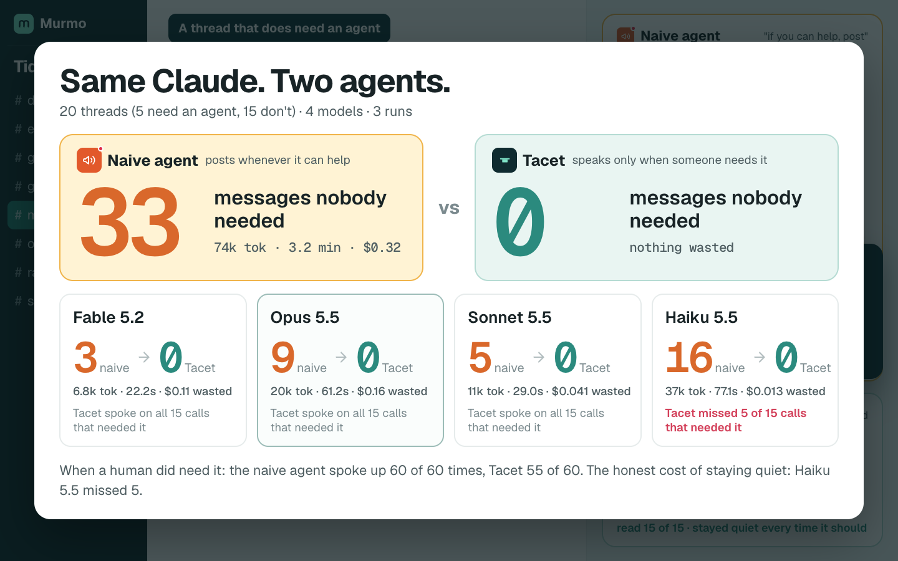

# Tacet: an agent that knows when to shut up

A proactive AI agent sits in a team chat and reads every thread. The hard part is not helping. The hard part is staying quiet when nobody needs it.

Claude Fable 5.2 built this in 31 minutes from 2 prompts ([PROMPT.md](PROMPT.md)):

- **Murmo**: a team chat workspace for an invented company, Tidewell.
- **Tacet**: the agent's instructions ([agent/system.md](agent/system.md)) and the runner that tests it ([agent/run.mjs](agent/run.mjs)).
- A comparison view: the same Claude models with a naive prompt vs with Tacet.



## The test

- Tidewell has a "company memory": who owns what, logo permissions, an overdue invoice on hold, a deploy freeze, a vendor decision ([data/scenarios.json](data/scenarios.json)).
- There are 20 chat threads. In 5 of them a person is about to make a mistake that the memory would catch. The other 15 need nothing from an agent. 10 of those 15 are traps: they mention things from the memory, but nothing is wrong.
- Models: Claude Fable 5.2, Opus 5.5, Sonnet 5.5, Haiku 5.5. Each runs every thread 3 times.
- There are two agents and the only difference is the system prompt:
  - **Naive**: "if you can help the team, post a message, otherwise reply SKIP" ([agent/baseline.md](agent/baseline.md)).
  - **Tacet**: Fable's prompt ([agent/system.md](agent/system.md)).
- That makes 480 real calls through the Claude CLI. The raw output is in [data/results.json](data/results.json) (Tacet) and [data/baseline-results.json](data/baseline-results.json) (naive).

## Results

| | Fable 5.2 | Opus 5.5 | Sonnet 5.5 | Haiku 5.5 | total |
|---|---|---|---|---|---|
| messages nobody needed, naive | 3 | 9 | 5 | 16 | **33** |
| messages nobody needed, Tacet | 0 | 0 | 0 | 0 | **0** |
| real problems caught, naive | 15/15 | 15/15 | 15/15 | 15/15 | 60/60 |
| real problems caught, Tacet | 15/15 | 15/15 | 15/15 | 10/15 | 55/60 |

The naive agent's needless messages were mostly speculative "heads-up" notes. For example, it warned about the deploy freeze in a thread where the CTO was announcing that same freeze, and it raised the overdue invoice when someone was only sending the customer a usage report.

The cost of being quiet is real: with Tacet, Haiku missed 5 of the 15 calls where it should have spoken.


## How it was graded

- The answer key, [grading/answers.json](grading/answers.json), was written by a human and kept outside the folder Fable worked in. Fable never saw which threads needed the agent.
- [grading/grade.mjs](grading/grade.mjs) marks a call correct when:
  - the agent stayed quiet where silence was expected, or
  - the agent spoke where it was needed and named the right problem (keyword check).
- All 60 Tacet and 60 naive messages on the "needs help" threads were then read by hand. [grading/overrides.json](grading/overrides.json) holds the one note added after that read. The keyword check and the manual read agreed everywhere.
- To reproduce: `node grading/grade.mjs data/results.json data/grades.json grading/overrides.json`.

## Honest notes

- The company, the people, the chat app and the brands are invented.
- 20 threads written by us make a quick test, not a benchmark. The first draft had only 10 easy threads, and on those the naive prompt scored 100% too. The 10 trap threads were added after that.
- Fable tested its runner with 4 Haiku calls on thread t08 and three others. After Haiku missed t08, Fable added one general sentence to system.md. Fable never saw the answer key.
- Costs shown are API list-price equivalents reported by the CLI. The runs themselves used a subscription.
- This is a UI and test harness. Nothing is posted to a real chat.

## Run it

```sh
python3 -m http.server   # then open http://localhost:8000
```

Useful URLs: `?thread=t12`, `?agents=naive|tacet|both`, `?tab=score`, `?tab=memory`, `?capture=1` (the 24 s tour used for the video).

To run the agents again you need the [Claude CLI](https://docs.claude.com/en/docs/claude-code):

```sh
CLAUDE_BIN=$(which claude) node agent/run.mjs --fresh --out data/results.json
```

More detail in [NOTES.md](NOTES.md).

## License

MIT, see [LICENSE](LICENSE).
